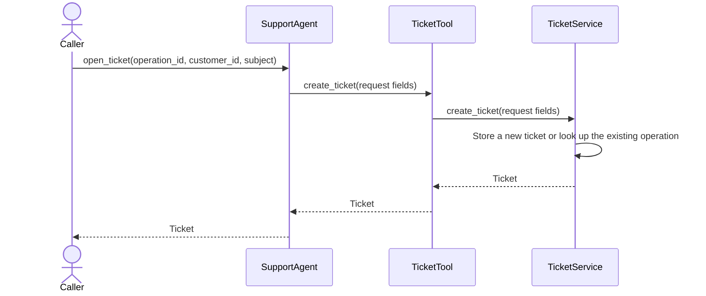

# Agentic Service Ticket Creation

A small Python demo of a support agent opening service tickets through a tool.

## Architecture



1. The caller invokes `SupportAgent.open_ticket` with an operation ID, a customer ID, and a subject. The agent retries once on a timeout with the same request fields.
2. `TicketTool.create_ticket` forwards the request to the service through a typed interface.
3. `TicketService.create_ticket` stores one ticket per operation ID. Repeating an operation ID with the same customer ID and subject returns the original ticket. Reusing it with different details raises `ValueError` and leaves storage unchanged.

## Repository overview

| File | Purpose |
| --- | --- |
| `README.md` | Project overview and local usage. |
| `AGENTS.md` | Repository instructions for coding agents. |
| `pyproject.toml` | Project metadata and Python version requirement. |
| `src/support_agent/__init__.py` | Marks `support_agent` as a Python package. |
| `src/support_agent/__main__.py` | Runs the ticket creation example from the command line. |
| `src/support_agent/agent.py` | Agent entry point and retry policy. |
| `src/support_agent/tools.py` | Typed adapter between the agent and ticket service. |
| `src/support_agent/ticket_service.py` | Ticket data model and in-memory storage. |
| `tests/test_ticket_service.py` | Tests ticket creation, identical replays, and conflicting requests. |
| `tests/test_retry_behavior.py` | Tests ticket creation when the agent retries. |

## Try it locally

Use Python 3.13 or later. The demo uses only the standard library. From the repository root, run:

```sh
PYTHONPATH=src python3 -B -m support_agent
```

The example prints the created ticket. Deduplication applies to sequential calls within one service instance. Tickets are stored in memory and are not shared across instances or retained after a restart.

## Run the ticket creation tests

```sh
PYTHONPATH=src python3 -B -m unittest discover -s tests -p 'test_ticket_service.py' -v
```
